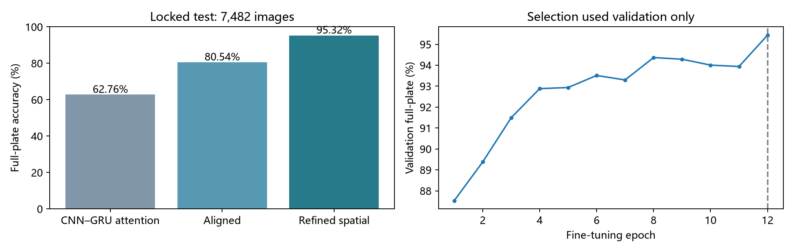
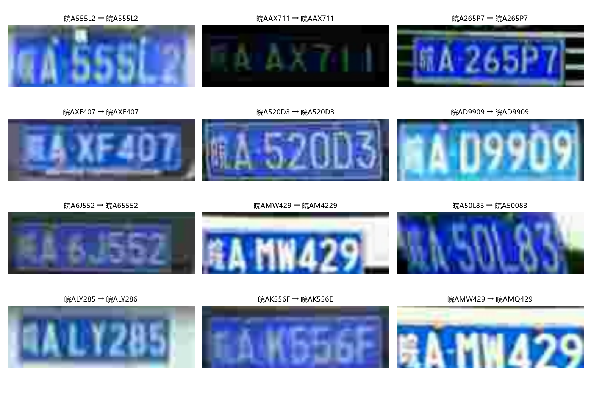
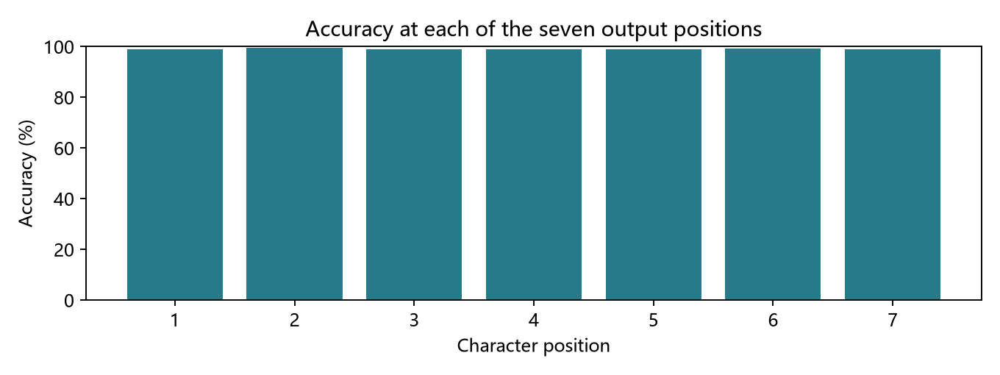
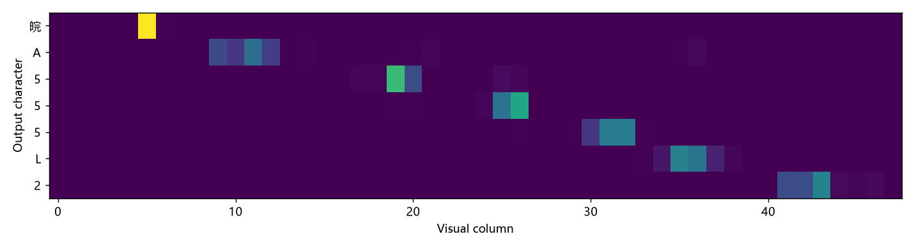

# Task 3 — CNN encoder + GRU decoder nhận dạng biển số

Bản nháp từ artifact thật, tạo 2026-11-17T01:26:32.

## 1. Bài toán và dữ liệu

Nhận dạng toàn bộ chuỗi bảy ký tự từ ảnh biển số. Dataset là cohort 50.000 ảnh CCPD-Base, gồm ký tự tỉnh, một chữ cái và năm chữ/số tiếp theo. Crop dùng bounding box annotation; không tuyên bố đã xây detector từ ảnh cả xe. Chia theo toàn chuỗi biển số, không trùng plate giữa train/validation/test. Đây là benchmark nội bộ của cohort đã chọn, không phải giao thức test chính thức để so trực tiếp với mọi bài báo.

| Tập | Ảnh | Plate groups |
| --- | ---: | ---: |
| train | 35043 | 31481 |
| validation | 7475 | 6746 |
| test | 7482 | 6747 |

## 2. Tiền xử lý và kiến trúc

Ảnh crop được chuyển RGB, resize 192×64 và chia 255. CNN có ba block Conv–ReLU–Pool, tạo [B,128,8,48]. Bản baseline lấy trung bình chiều cao và lặp global context bảy lần. Bản aligned dùng Linear(8×128,128) giữ thông tin trên/dưới của ký tự; AdaptiveAvgPool1d(7) tạo bảy vùng trái–phải. Bản refined thêm nhánh hai Conv 3×3 residual (hệ số 0,1) và vector vị trí cho 48 cột. Nhánh residual và vị trí khởi tạo bằng 0, giữ nguyên hàm dự đoán của checkpoint aligned trước fine-tune. Mỗi bước GRU nhận hỗn hợp local/global (hệ số 0,5), attention trên 48 cột và Linear(256,67). Output logits [B,7,67], argmax tạo đủ bảy ký tự. Không dùng nhãn tương lai hoặc dịch vụ OCR ngoài.

| Layer / phép biến đổi | Shape |
| --- | --- |
| Input RGB | `[B,3,64,192]` |
| Conv 3→32, ReLU, Pool 2×2 | `[B,32,32,96]` |
| Conv 32→64, ReLU, Pool 2×2 | `[B,64,16,48]` |
| Conv 64→128, ReLU, Pool 2×1 | `[B,128,8,48]` |
| Residual: Conv–ReLU–Conv, cộng hệ số 0,1 | `[B,128,8,48]` |
| Ghép chiều cao + Linear 1024→128 + vị trí cột | `[B,48,128]` |
| AdaptiveAvgPool1d(7), trộn 0,5 local + 0,5 global | `[B,7,128]` |
| GRU decoder, hidden ban đầu = global context | `[B,7,128]` |
| Dot attention: query decoder, memory 48 cột | `[B,7,128]` |
| Ghép decoder/context, Linear 256→67 | `[B,7,67]` |
| Argmax, tra vocabulary | `B chuỗi × 7 ký tự` |

## 3. Thiết lập huấn luyện

Khởi tạo theo chuỗi baseline attention → aligned (4 epoch) → refined, tất cả chỉ học train; không khởi tạo từ test. Seed 42; batch 16; Adam với CNN lr=3e-05, projection lr=0.0003, decoder/classifier lr=0.0001, residual lr=0.0001, vị trí lr=0.001; cross-entropy, gradient clipping 1.0. Scheduler giảm LR theo validation CE. Ngân sách thực tế là 12 epoch fine-tune, giới hạn cấu hình 24; chốt sau review validation và giữ checkpoint epoch 12 theo full-plate accuracy, tie-break CER. Một seed fine-tune, không phải ba lần train độc lập. Thời gian bảng chỉ thuộc từng run; warm start còn dùng công huấn luyện baseline trước đó. Batch nhỏ và nghỉ giữa batch làm thời gian không thể so như benchmark tốc độ thuần.

## 4. Kết quả test độc lập

Cấu hình và hash checkpoint được khóa trước khi mở test. Test gồm 7.482 ảnh, giữ nguyên toàn bộ ảnh khó. Mô hình mới đọc đúng hoàn toàn 7.132/7.482 ảnh, còn 350 ảnh sai ít nhất một ký tự; full-plate accuracy 95.32%, character accuracy 99.15% và CER 0.85%. So với baseline trên cùng tập test, tăng 32.56 điểm phần trăm full-plate accuracy. Không chọn lại model bằng các điểm test này.

| Model | Seed | Full-plate % | Character % | CER % |
| --- | ---: | ---: | ---: | ---: |
| CNN–GRU attention | 42 | 62.764 | 92.743 | 7.236 |
| Aligned CNN–GRU | 42 | 80.540 | 96.353 | 3.637 |
| Refined spatial CNN–GRU | 42 | 95.322 | 99.148 | 0.846 |

## 5. Định nghĩa metric và yêu cầu PDF

Full-plate accuracy là tỷ lệ đúng cả bảy ký tự. Character accuracy tính theo vị trí. CER là tổng Levenshtein edit distance chia tổng ký tự thật. R²/NSE/MAE/RMSE trong phụ lục được tính trên decoded binary one-hot đã flatten, không hồi quy trên character ID. R² và NSE bằng nhau theo công thức residual. Các metric one-hot chỉ là chẩn đoán phân loại phụ, không có ý nghĩa khoảng cách số học giữa biển số và không thay cho accuracy toàn biển.

| Model | R² phụ | NSE phụ | MAE phụ | RMSE phụ |
| --- | ---: | ---: | ---: | ---: |
| CNN–GRU attention | 0.85265 | 0.85265 | 0.00217 | 0.04654 |
| Aligned CNN–GRU | 0.92596 | 0.92596 | 0.00109 | 0.03299 |
| Refined spatial CNN–GRU | 0.98271 | 0.98271 | 0.00025 | 0.01594 |

## 6. Phân tích và giới hạn

Kết quả cải thiện là tổ hợp thay đổi kiến trúc và fine-tuning, không phải một ablation tách riêng tác dụng từng thành phần. Dữ liệu cố định bảy ký tự, crop bằng annotation và đa số cùng dạng biển; cần thận trọng khi suy rộng sang quốc gia, biển biến độ dài hoặc detector thực tế. Ảnh mờ, nghiêng và ký tự gần hình vẫn gây lỗi. Chỉ có một seed fine-tune cho model mới nên chưa ước lượng được phương sai giữa các lần train. Hình minh họa lấy các trường hợp đầu theo thứ tự cố định, không chọn thủ công chỉ ảnh đẹp.

## 7. Nguồn và khả năng tái lập

Yêu cầu: assignments/Final Project Requirements 2026.pdf. Dataset: https://github.com/detectRecog/CCPD . Adaptive pooling: https://docs.pytorch.org/docs/stable/generated/torch.nn.AdaptiveAvgPool1d.html . Code: task3/code/refined_model.py, task3.py và train_advanced.py; config: task3/config/refined.json. Manifest/vocabulary ở data/splits. Checkpoint, source snapshot, history, prediction CSV, metric và hash khóa test ở run/task3. Không sửa assignment PDF hoặc template Word gốc.
